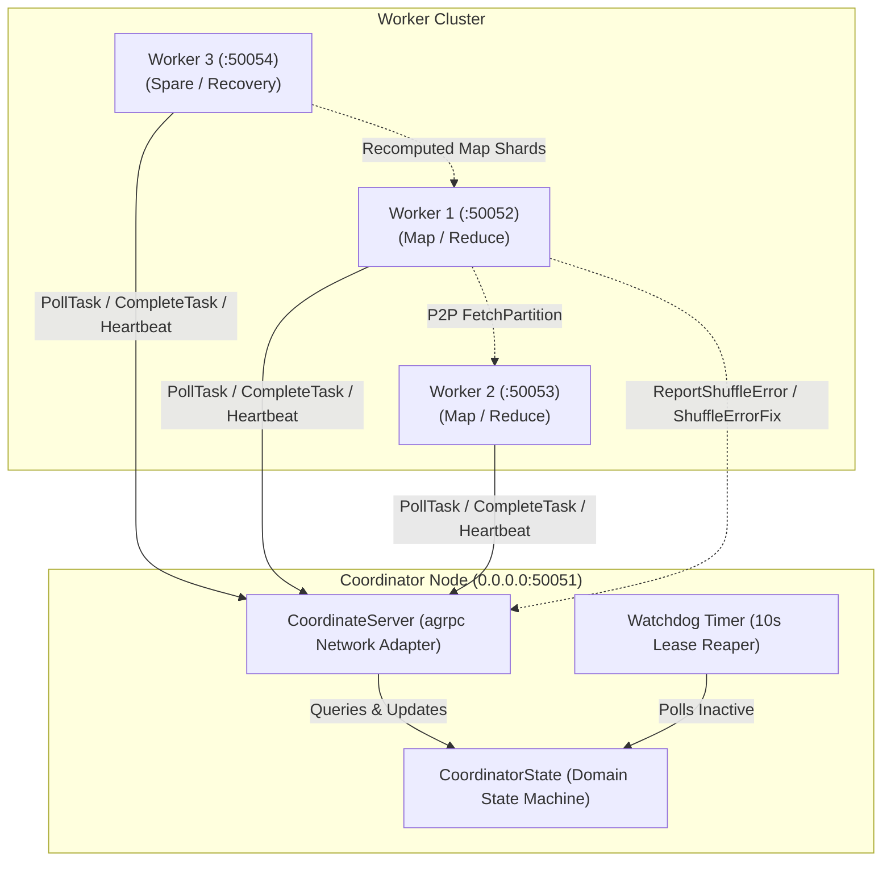
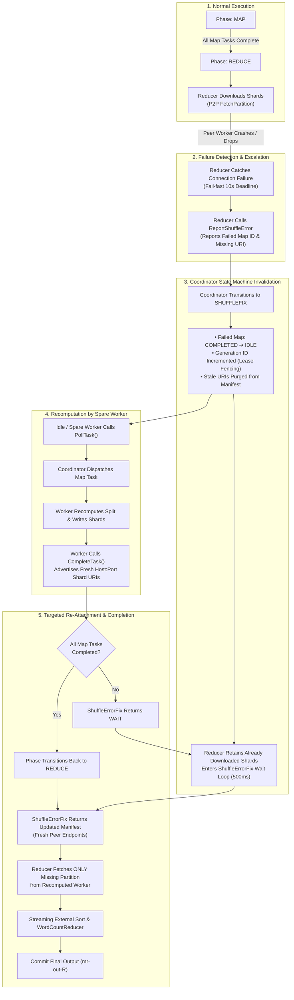
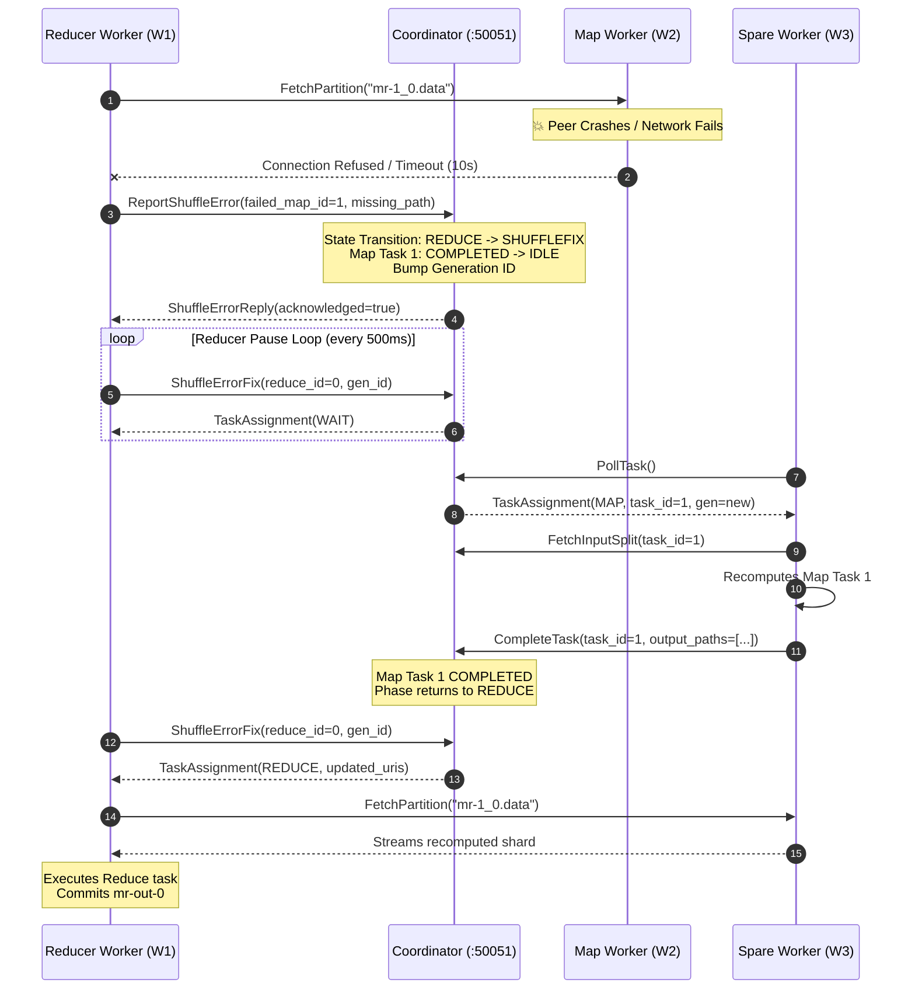

# Distributed MapReduce Framework (C++20)

[](https://en.cppreference.com/w/cpp/20)
[](https://www.boost.org/doc/libs/release/doc/html/boost_asio.html)
[](https://github.com/Tradias/asio-grpc)
[](https://grpc.io/)
[](LICENSE)

A asynchronous distributed MapReduce  implemented in **C++23**.  it uses  **Boost.Asio C++20 coroutines**, **asio-grpc (`agrpc`)**, atomic storage staging, and a fault recovery protocol (**`SHUFFLEFIX`**) with lease fencing.

---

## Table of Contents

- [Architectural Overview](#architectural-overview)
- [System Architecture](#system-architecture)
- [Core Components](#core-components)
  - [Coordinator Subsystem](#1-coordinator-subsystem)
  - [Worker Subsystem](#2-worker-subsystem)
  - [Storage & Execution Engine](#3-storage--execution-engine)
- [Fault Tolerance & `SHUFFLEFIX` Protocol](#fault-tolerance--the-shufflefix-protocol)
- [Repository Layout](#repository-layout)
- [Prerequisites & Build Guide](#prerequisites--build-guide)
- [Running the Cluster](#running-the-cluster)
- [Testing & Verification](#testing--verification)

---

## Architectural Overview

The engine executes distributed batch data processing modeled on Google's MapReduce paper, extended with modern asynchronous C++ patterns:

- **Asynchronous Coroutine Driven**: All networking and disk I/O are driven by C++20 coroutines (`co_await`, `boost::asio::awaitable`) on top of Boost.Asio and `agrpc`.
- **Decoupled State Machine Architecture**: State progression and RPC adapters are strictly separated. The domain logic (`CoordinatorState`, `WorkerState`) contains zero network dependencies.
- **Lease Fencing Tokens**: Every task assignment issues an incrementing `generation_id` lease token. Stale commits from timed-out or frozen zombie workers are rejected deterministically.
- **P2P Shuffle Transfer**: Reducers download intermediate partition files directly from Map workers over peer-to-peer streaming gRPC (`WorkerShuffleService`), eliminating coordinator bottleneck.
- **Collocated Partition Optimization**: Reducers identify shards generated by their own worker process and hard-link them locally on disk, avoiding loopback network transfers.
- **Incremental Fault Escalation (`SHUFFLEFIX`)**: If a Map worker crashes during the Shuffle phase, the coordinator invalidates *only* the missing Map task. Reducers pause in an asynchronous wait loop and retain already downloaded healthy shards on local disk.

---

## System Architecture



---

## Core Components

### 1. Coordinator Subsystem
- **`mr::CoordinatorState`** (`coordinator/state.hpp`, `coordinator/state.cpp`):
  - In-memory state machine tracking the cluster phase (`CONFIGURE -> MAP -> REDUCE -> SHUFFLEFIX -> DONE`).
  - Generates line-aligned byte splits (`InputSplit`) across raw input text without cutting words.
  - Manages `map_tasks` and `reduce_tasks` catalogs, lease generation tokens, and worker heartbeats.
- **`mr::CoordinateServer`** (`coordinator/server.hpp`, `coordinator/server.cpp`):
  - Async gRPC server binding RPC handlers to `control_grpc_context_` and `data_grpc_context_`.
  - Runs a 10-second watchdog lease timer to detect crashed workers and re-queue uncommitted tasks to `IDLE`.
  - Streams input splits via `FetchInputSplit` through a bounded `concurrent_channel` (64 chunks × 64 KB = 4 MB buffer) on a dedicated disk strand.

### 2. Worker Subsystem
- **`mr::WorkerState`** (`worker/state.hpp`, `worker/state.cpp`):
  - Manages task assignment state, temporary directory paths, and URI validation (`ValidateParseP2pUri`) with strict path traversal defenses.
  - Invokes user mapper and reducer functions.
- **`mr::WorkerServer`** (`worker/server.hpp`, `worker/server.cpp`):
  - Runs the control loop (`start_worker()`) polling the coordinator for tasks.
  - Runs a background heartbeat supervisor (`start_heart_beats()`) pinging the coordinator every 2 seconds.
  - Hosts `ww::WorkerShuffleService` to stream intermediate partitions (`mr-<M>_<R>.data`) to peer reducers.
  - Manages nested `boost::asio::cancellation_signal` trees to abort disk writes and network streams immediately upon task lease expiration or shutdown.

### 3. Storage & Execution Engine
- **Binary Framing (`RecordReader` / `RecordWriter`)**: Little-endian binary record serialization storing `[key_len: uint32][val_len: uint32][key_bytes][val_bytes]`.
- **Atomic Two-Phase Commits (`StagedRecordWriter`)**: All intermediate shards and final outputs are written to temporary staging files (`.tmp_stage_<pid>_<seq>_<filename>`) and atomically renamed upon clean commit, guaranteeing zero corrupt partial files.
- **Bounded External Sorting (`StreamingValueIterator`)**:
  - In-place sorting of individual intermediate shards.
  - Multi-way $K$-way min-heap merge over active partition readers, delivering monotonically ordered keys to `WordCountReducer` without requiring all values in memory.

---

## Fault Tolerance & The `SHUFFLEFIX` Protocol

When an intermediate Map worker crashes during the shuffle phase, the cluster recovers automatically without restarting the entire job.

### Fault Recovery State & Control Graph



### P2P Protocol Sequence



---

## Repository Layout

```text
.
├── CMakeLists.txt                # Root CMake build definition
├── coordinator/                  # Coordinator server and state machine
│   ├── main.cpp                  # Coordinator entry point
│   ├── server.hpp / .cpp         # Async gRPC server adapter (agrpc)
│   └── state.hpp / .cpp          # Core MapReduce coordination state machine
├── worker/                       # Worker server and execution runtime
│   ├── main.cpp                  # Worker entry point
│   ├── server.hpp / .cpp         # Async P2P shuffle server & client
│   └── state.hpp / .cpp          # Local task execution & URI validation
├── proto/                        # Protocol Buffer definitions
│   ├── mr_coordination.proto     # Coordinator <-> Worker RPCs
│   └── shuffle.proto             # Worker <-> Worker P2P Shuffle RPCs
├── include/                      # Reusable engine and storage headers
│   ├── core/                     # Mapper, Reducer, Partitioner interfaces
│   ├── engine/                   # StreamingValueIterator, EmitContexts
│   └── storage/                  # RecordReader, StagedRecordWriter, SplitReader
├── src/storage/                  # Storage implementation files
├── scripts/                      # Automated cluster testing and verification
│   ├── test_fault_recovery_visual.py # Live step-by-step failure demonstration
│   ├── test_shuffle_stress.py    # Multi-worker shuffle recovery stress test
│   └── run_cluster.sh            # Local cluster launch script
└── tests/                        # Comprehensive unit test suite (94 tests)
```

---

## Prerequisites & Build Guide

### Prerequisites
- **Linux** (tested on Ubuntu 22.04 / 24.04, WSL2)
- **C++20 Compiler**: GCC 13+ or Clang 16+
- **CMake**: >= 3.25
- **Dependencies**: Boost (>= 1.82), gRPC, Protocol Buffers, `asio-grpc` (via vcpkg)

### Building from Source

```bash
# 1. Configure the build directory
cmake --preset ninja-vcpkg-release
# or standard cmake:
cmake -B build -DCMAKE_BUILD_TYPE=Release

# 2. Compile the binaries
cmake --build build -j$(nproc)
```

Target binaries will be generated in:
- `./build/coordinator/coordinator`
- `./build/worker/worker`
- `./build/tests/sequential_harness`

---

## Running the Cluster

### 1. Start the Coordinator
```bash
./build/coordinator/coordinator <input_file> [-p port] [-r reducers] [-s split_bytes]

# Example: Run on port 50051 with 2 reducers and 64KB split size
./build/coordinator/coordinator data/sample.txt -p 50051 -r 2 -s 65536
```

### 2. Start Workers
Start one or more workers in separate terminals (or distributed across nodes):
```bash
./build/worker/worker -c <coord_host:port> -p <worker_listen_port> -h <advertised_host>

# Worker 1:
./build/worker/worker -c 127.0.0.1:50051 -p 50052 -h 127.0.0.1

# Worker 2:
./build/worker/worker -c 127.0.0.1:50051 -p 50053 -h 127.0.0.1

# Worker 3 (Spare):
./build/worker/worker -c 127.0.0.1:50051 -p 50054 -h 127.0.0.1
```

---

## Testing & Verification

### 1. Full Unit Test Suite (94 Tests)
Run the automated CTest suite covering endian safety, record readers/writers, input splitters, streaming iterators, and sequential harness pipelines:
```bash
ctest --test-dir build --output-on-failure
```

### 2. Live Fault Recovery Demonstration
Watch failure detection, worker termination, SHUFFLEFIX state transition, recomputation by a spare worker, and final verification in real time:
```bash
python3 scripts/test_fault_recovery_visual.py
```

### 3. Shuffle Recovery Stress Test
Executes a high-throughput job (~40,000 lines, 4 workers, 2 reducers), injects a crash mid-flight, purges intermediate shards, and programmatically verifies 100% data fidelity against the sequential ground truth:
```bash
python3 scripts/test_shuffle_stress.py
```
